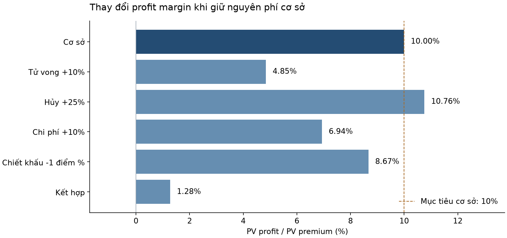
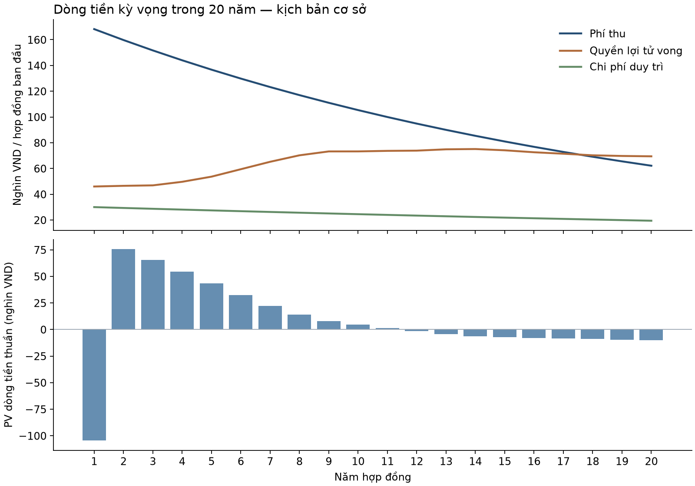

# Định phí và kiểm tra khả năng sinh lời bảo hiểm tử kỳ

**Life Insurance Pricing & Profit Testing — Python, Excel**

Project học tập ở mức actuarial intern: dự phóng hợp đồng, giải mức phí năm để đạt profit margin mục tiêu, chạy stress và đối chiếu hai cách triển khai. Tài liệu viết bằng tiếng Việt; giữ thuật ngữ chuyên môn cần thiết.

Sản phẩm minh họa: nam 30 tuổi, không hút thuốc, bảo hiểm tử kỳ 20 năm, quyền lợi tử vong 100 triệu VND. Không có quyền lợi sống đến đáo hạn hay giá trị hoàn lại khi hủy. Các số tiền trong báo cáo tính trên **một hợp đồng ban đầu**.

## Kết quả phát hành

- Phí cơ sở chưa làm tròn thương mại: **168.227,000069 VND/năm**.
- Profit margin cơ sở: **10,00%**; PV dòng tiền thuần khoảng **152.005 VND**.
- Tử vong +10% làm margin giảm còn **4,85%** khi giữ nguyên phí.
- Kịch bản kết hợp cho margin **1,28%**; tăng lapse riêng lẻ cho margin **10,76%** trong thiết kế này.
- **14 bài kiểm thử Python** đạt; **3.174 phép đối chiếu Python–Microsoft Excel** đạt, gồm dòng tiền từng năm của cả sáu kịch bản.



## Nội dung

| Tệp | Dùng để làm gì |
| --- | --- |
| [excel/mo_hinh_dinh_phi.xlsx](excel/mo_hinh_dinh_phi.xlsx) | Mô hình có công thức, input editable, kết quả và bản chụp so sánh |
| [src/model.py](src/model.py) | Thuật toán dự phóng, giải phí và kiểm tra đầu vào |
| [reports/tom_tat_dieu_hanh.md](reports/tom_tat_dieu_hanh.md) | Báo cáo ngắn: kết quả, nhận xét, đề xuất |
| [docs/phuong_phap.md](docs/phuong_phap.md) | Công thức, định nghĩa, quy ước thời điểm, dẫn xuất premium solver |
| [docs/huong_dan_su_dung.md](docs/huong_dan_su_dung.md) | Các bước thay input, chạy lại và đọc Excel |
| [docs/kiem_tra_va_doi_chieu.md](docs/kiem_tra_va_doi_chieu.md) | Các kiểm tra, ngưỡng, cách đọc bằng chứng |
| [docs/cv_va_phong_van.md](docs/cv_va_phong_van.md) | Cách mô tả project và trả lời câu hỏi |
| [DATA_SOURCES.md](DATA_SOURCES.md) | Nguồn dữ liệu và phân biệt dữ liệu công khai/giả định |
| [CONTRIBUTIONS.md](CONTRIBUTIONS.md) | Phạm vi đóng góp và hỗ trợ AI |

## Chạy bằng Python

Yêu cầu Python 3.10 trở lên. Mô hình và tests chỉ dùng thư viện chuẩn:

```bash
python -m unittest discover -s tests -v
python scripts/run_project.py
```

Lệnh thứ hai tự giải phí cơ sở, giữ mức phí đó cho sáu kịch bản, rồi xuất CSV vào `results/`. Nếu muốn tự đặt phí:

```bash
python scripts/run_project.py --fixed-premium 180000
```

Để tạo lại hình:

```bash
python -m pip install -r requirements.txt
python scripts/create_figures.py
```

Sửa giả định trong `data/assumptions.json`, mức stress trong `data/scenarios.json`. File `data/mortality.csv` có qₓ cho tuổi 30–49. Thời hạn tối đa 20 năm, tuổi cuối phải nằm trong bảng nguồn. Sửa đầu vào sẽ làm kết quả khác báo cáo phát hành; cập nhật báo cáo nếu muốn công bố kết quả mới.

## Tái chạy đối chiếu Excel

Yêu cầu Windows và **Microsoft Excel desktop**. Chạy Python mặc định trước (không dùng phí tùy chọn trong quy trình đối chiếu mặc định), sau đó:

```powershell
powershell -NoProfile -ExecutionPolicy Bypass -File scripts/verify_excel.ps1
python scripts/reconcile.py
```

Script mở một phiên Excel riêng, nạp cùng dữ liệu JSON/CSV, thực hiện full recalculation cho sáu kịch bản, xuất kết quả và đóng mà không lưu thay đổi vào workbook. Chạy `reconcile.py` để so sánh với Python. Trên Linux/macOS vẫn chạy được Python; bằng chứng Excel đã kiểm tra nằm trong `results/`. GitHub Actions chỉ chạy tests và Python, không tuyên bố tái chạy Microsoft Excel.

Bảng so sánh trong workbook là **bản chụp của cấu hình phát hành**, không tự thay theo selector. Mô hình đang chọn và các KPI chính tự cập nhật khi thay input. Kết quả CSV mới không tự ghi ngược vào bảng chụp; xem kết quả mới trong `results/excel_scenarios.csv`.

## Phạm vi nghiệp vụ

qₓ trích từ phần Ultimate của [SOA MORT 2015 VBT, table 3269](https://mort.soa.org/ViewTable.aspx?TableIdentity=3269), không phải dữ liệu khách hàng thực tế Việt Nam. Các giả định lapse, chi phí, hoa hồng, inflation và margin là minh họa do project lựa chọn.

Profit ở đây là **PV dòng tiền thuần kỳ vọng trước reserve, vốn, thuế và tái bảo hiểm**. Discount rate là lãi suất để chiết khấu, không phải mô hình thu nhập đầu tư riêng. Project chưa tính IFRS 17, CSM, dự phòng pháp định, capital strain hay shareholder profit đầy đủ. Mục tiêu là hiểu và kiểm soát mô hình cơ bản.



## Repository công khai

Repository: [life-insurance-pricing-profit-testing](https://github.com/datvt200805-oss/life-insurance-pricing-profit-testing). Giữ nguyên thư mục con khi tải về để các liên kết README và hình hoạt động. Xem [hướng dẫn GitHub](docs/huong_dan_github.md) nếu dùng Git.

Mã và tài liệu có hỗ trợ AI, công khai trong CONTRIBUTIONS. Không trình bày là phần mềm định phí đã được công ty bảo hiểm phê duyệt.
